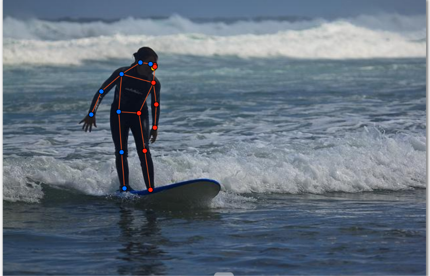
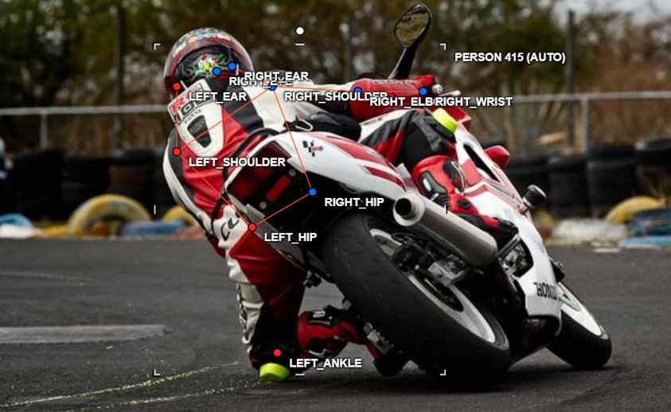
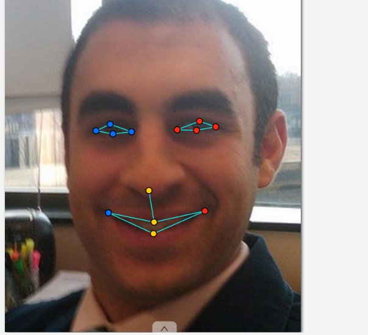

# Báo cáo cá nhân — NguyenThiNgoc-2A202603236

Đổi tên file theo quy tắc `MSSV_HoTen.md`. Ví dụ: `20241234_NguyenVanAn.md`.

Dữ liệu: 12 ảnh người COCO val2017 (Lin et al., 2014) và 8 ảnh chân dung Wikimedia Commons, chỉ dùng trong lớp.

## 0. Thông tin học viên

- Họ tên: Nguyễn Thị Ngọc
- MSSV: 2A202603236
- Link repository: https://github.com/ngocngoc0406/K5-L2-DAY04-NguyenThiNgoc-2A202603236-KeypointPose
- Phiên bản CVAT (Help → About): 2.82
- Máy: hệ điều hành Windows · RAM 16 GB · chạy CVAT chế độ đầy đủ
- Bộ ảnh (`src/exports/assignment.json` do `lab.py setup` tạo): có
- Giờ bắt đầu:
- Giờ kết thúc:

## 1. Kiểm tra label (CP0)

| Label | Kiểu | Số điểm | Tên điểm đúng bảng của lab? | Đúng thứ tự? | Số cạnh |
|---|---|---:|---|---|---:|
| `person` | Skeleton | 17 | Có | Có | 19 |
| `face` | Skeleton | 13 | Có | Có | 13 |

Mẫu `person` dựng theo người quay mặt về camera (các điểm `left_*` nằm bên phải khung mẫu)? Có

Cách đổi cờ `occluded` / `outside` cho **một điểm** trên phiên bản CVAT này (một câu):
Rê chuột vào điểm cần đổi rồi bấm phím `Q` để đổi `occluded` (v = 1), bấm phím `O` để đổi `outside` (v = 0), hoặc bấm chuột phải vào điểm để chọn cờ.

## 2. Số lượng đã gán và thời gian (CP1, CP2)

| Nhóm ảnh | Số ảnh | Số skeleton đã gán | Số người dưới 60 px (không gán) | Số poster / gương / màn hình bỏ qua | Thời gian (phút) |
|---|---:|---:|---:|---:|---:|
| `easy` | 5 | 7 | 0 | 0 | 25 |
| `occluded` | 3 | 5 | 0 | 0 | 25 |
| `back` | 2 | 4 | 0 | 0 | 20 |
| `small` | 1 | 5 | 4 | 0 | 15 |
| `crowd` | 1 | 3 | 0 | 0 | 15 |
| `faces` | 8 | 8 | 0 | — | 25 |

- Số ảnh người đã xong ở mốc phút 105: 10 / 10
- Thời gian thực tế (phút): CP1 100 · CP2 25 · CP3 20
- Ảnh tốn thời gian nhất là ảnh nào, vì sao?
Ảnh `000000272026.jpg` (ảnh 3 người phụ nữ ngồi bàn ăn) và `000000122199.jpg` (2 người leo núi tuyết) vì có nhiều người, các chi và khớp bị che khuất một phần bởi bàn ghế, trang phục mùa đông và mép khung ảnh.

## 3. Bảng ca khó (CP1, CP2)

Mỗi điểm bạn phân vân một dòng, nhất là phân vân giữa `v = 1` và `v = 0`, hoặc không chắc hướng người.

| Ảnh | Người / mặt | Điểm | Cờ đã chọn | Phân vân giữa | Lý do chọn |
|---|---|---|---:|---|---|
| `000000122199.jpg` | Người leo núi áo xám (#2) | `left_elbow` | 0 | `v = 1` và `v = 0` | Khớp khuỷu tay trái nằm tràn ra ngoài mép phải ảnh (x = 481.8 > 480). Theo quy định, điểm nằm ngoài khung ảnh bắt buộc phải chọn `outside` (v = 0) thay vì kéo về mép hay để v = 2. |
| `000000515309.jpg` | Tay đua mô tô ôm cua | `nose`, `left_knee`, `right_ankle` | 0 | `v = 1` và `v = 0` | Người lái mô tô quay lưng lại camera và nghiêng người sát mặt đường, đầu đội mũ bảo hiểm che kín mặt, chân bị thân xe che khuất hoàn toàn nên các điểm này chọn `outside` (v = 0). |
| `000000177889.jpg` | Người lướt sóng trên biển | `right_ear`, `nose` | 1 | `v = 2` và `v = 1` | Người lướt sóng đang quay nghiêng và nhìn hướng về phía trước sóng, vùng tai và mũi bị góc nhìn nghiêng che khuất một phần; chọn `occluded` (v = 1) do góc mặt vẫn ước lượng được vị trí tương đối. |
| `000000272026.jpg` | Người phụ nữ ngồi giữa bàn (#2) | `left_knee`, `right_knee` | 0 | `v = 1` và `v = 0` | Toàn bộ chân dưới bị mặt bàn gỗ che khuất hoàn toàn, không đủ căn cứ để ước lượng tin cậy vị trí đầu gối nên chọn `outside` (v = 0) để tránh sinh heatmap sai lệch cho model. |

## 4. Bảng tự review (CP3)

Đi từ ảnh cuối về ảnh đầu. 5 ảnh người (ít nhất 2 ảnh `back` hoặc `crowd`) và 3 ảnh mặt. Ít nhất 8 dòng, kể cả dòng `ok`. Ghi lỗi trước, sửa sau.

Mã lỗi dùng đúng một trong: `lr_swap`, `vis_flag`, `position`, `missing`, `extra`, `ok`.

| Ảnh | Người / mặt | Điểm | Mã lỗi | Ghi chú | Đã sửa? |
|---|---|---|---|---|---|
| `000000122199.jpg` | Người leo núi áo xám (#2) | `left_elbow` | `vis_flag` | Điểm nằm ngoài mép ảnh nhưng để v = 2 làm script báo lỗi, đã đổi sang `outside` (v = 0) | Có |
| `000000515309.jpg` | Tay đua mô tô ôm cua | `left_*`, `right_*` | `lr_swap` | Người quay lưng ôm cua, cần kiểm tra và đổi đúng các cặp left/right theo chiều nhìn của người lái xe | Có |
| `000000211458.jpg` | Bé trai bắt đĩa bay frisbee | `right_wrist`, `right_elbow` | `position` | Cánh tay vươn cao đón đĩa bay, cần phóng to để đặt chính xác vào tâm khớp cổ tay và khuỷu tay | Có |
| `000000272026.jpg` | Người phụ nữ ngồi bên trái (#1) | `left_ankle`, `right_ankle` | `position` | Người ngồi vắt chéo chân dưới gầm bàn, cần kiểm tra kỹ vị trí cổ chân trái và phải | Có |
| `000000438099.jpg` | Người ở hậu cảnh (#2, #3, #4) | Toàn thân | `extra` | Các người rất nhỏ (< 60 px) ở xa, đã rà soát lại để không gán dư thừa | Có |
| `face_141135.jpg` | Khuôn mặt nam (#1) | `left_eye_upper`, `left_eye_lower` | `position` | Điểm mí trên và mí dưới ban đầu hơi lệch về phía lông mi, đã chỉnh về đúng mép viền mí mắt | Có |
| `face_257657.jpg` | Khuôn mặt nghiêng (#1) | `right_eye_outer` | `ok` | Khóe ngoài mắt phải đặt chuẩn ở góc gặp nhau của mí mắt | Có |
| `face_362568.jpg` | Khuôn mặt đeo kính (#1) | `left_eye_*`, `mouth_*` | `ok` | Khóe miệng và các điểm mắt sau kính đặt chuẩn, không bị lệch | Có |

Tổng hợp số lỗi theo mã:

| `lr_swap` | `vis_flag` | `position` | `missing` | `extra` | `ok` |
|---:|---:|---:|---:|---:|---:|
| 1 | 1 | 3 | 0 | 1 | 2 |

Điểm còn phân vân giữa `v = 1` và `v = 0` (ghi cả hai lựa chọn và lý do chọn):
Khớp đầu gối và chân của những người ngồi sau bàn ăn trong ảnh `000000272026.jpg`. Chọn `v = 0` vì mặt bàn che khuất hoàn toàn tư thế chân, việc phỏng đoán sẽ có độ phân tán lớn giữa các annotator khác nhau; chọn `v = 0` an toàn hơn cho quá trình học của mô hình.

## 5. Kiểm file xuất và kết quả tự kiểm (CP4)

Tự kiểm tay trong file JSON:

| File | Người / mặt kiểm (ảnh, thứ tự) | Số phần tử `keypoints` | Điểm `outside` ra `v = 0`, `occluded` ra `v = 1`? | `num_keypoints` khớp? |
|---|---|---:|---|---|
| `NguyenThiNgoc_persons.zip` | 000000122199.jpg, người 1 | 51 | Đúng | Khớp (12 điểm v > 0) |
| `NguyenThiNgoc_persons.zip` | 000000122199.jpg, người 2 | 51 | Đúng (`left_elbow` ra v = 0) | Khớp (14 điểm v > 0) |
| `NguyenThiNgoc_faces.zip` | face_141135.jpg, mặt 1 | 39 | Đúng | Khớp (13 điểm v > 0) |

Sau khi xuất, CVAT ghi `occluded` thành `v = 1` và `outside` thành `v = 0`. Tọa độ của điểm `outside` trong file là `0, 0` hay tọa độ cũ? Tọa độ cũ (CVAT 2.x ghi tọa độ cũ; chuẩn COCO ghi 0, 0).

Hai job đã chuyển sang completed trên CVAT? Có

Dán phần **TÓM TẮT** in ra từ `src/check_submission.py`:

```text
- File person: NguyenThiNgoc_persons.zip
  Số ảnh: 12 · số skeleton `person`: 24 · mỗi annotation 51 số
  Skeleton theo ảnh: 000000090646=2, 000000122199=2, 000000157271=1, 000000163118=2, 000000177889=1, 000000211458=1, 000000261732=1, 000000272026=3, 000000294379=3, 000000399983=1, 000000438099=5, 000000515309=2
  Cờ v: v=2 263 (64%) · v=1 0 (0%) · v=0 145 (36%)
  num_keypoints trung bình: 11.0
- File face: NguyenThiNgoc_faces.zip
  Số ảnh: 8 · số skeleton `face`: 8 · mỗi annotation 39 số
  Skeleton theo ảnh: face_141135=1, face_196742=1, face_257657=1, face_296767=1, face_333134=1, face_362568=1, face_442231=1, face_505385=1
  Cờ v: v=2 104 (100%) · v=1 0 (0%) · v=0 0 (0%)
  num_keypoints trung bình: 13.0
- Ghi chú: 145 điểm v = 0 vẫn mang tọa độ cũ (CVAT 2.x xuất như vậy; chuẩn COCO ghi 0, 0). Không phải lỗi: điểm v = 0 bị bỏ qua khi huấn luyện và khi chấm.
- Số [LỖI]: 0 · số [CẢNH BÁO]: 10
Kết quả: ĐẠT (đọc lại từng cảnh báo ở trên)
```

Các `[CẢNH BÁO]` còn giữ nguyên và lý do:

- Cảnh báo người < 60 px ở các ảnh `000000294379`, `000000438099`, `000000515309`: Do người ở xa bị che khuất hoặc bị mép ảnh cắt ngang thân trên, chỉ thấy một phần cơ thể nên chiều cao điểm trải ra dưới 60 px.
- Cảnh báo bắt chéo chân ở `000000272026.jpg` (cặp ankle): Do người phụ nữ ngồi dưới bàn có tư thế bắt chéo chân thật sự ngoài đời thực.
- Cảnh báo hướng người ở `000000090646.jpg` và `000000163118.jpg`: Người quay hướng nghiêng / tư thế cử động phức tạp.

## 6. Ảnh chụp màn hình

1. Skeleton `person` đã gán đủ các điểm (người lướt sóng trên biển):

   

2. Một người quay lưng đã gán, cờ đã đặt (tay đua xe mô tô ôm cua trong ảnh `000000515309.jpg`):

   

3. Một khuôn mặt đã gán 13 điểm, phóng to vùng mắt:

   

4. Một đoạn JSON xuất của một người:

```json
{
  "id": 1,
  "image_id": 1,
  "category_id": 1,
  "segmentation": [],
  "area": 48818.72,
  "bbox": [
    157.81,
    124.16,
    123.09,
    396.61
  ],
  "iscrowd": 0,
  "attributes": {
    "occluded": false,
    "keyframe": false
  },
  "keypoints": [
    226.19, 133.27, 2,
    221.64, 124.16, 2,
    226.19, 124.16, 2,
    180.61, 128.72, 2,
    221.64, 128.72, 2,
    157.81, 183.42, 2,
    239.87, 178.86, 2,
    185.17, 233.57, 0,
    271.78, 238.13, 2,
    248.99, 174.30, 0,
    280.90, 197.10, 2,
    194.28, 320.18, 2,
    244.43, 320.18, 2,
    194.28, 425.03, 2,
    248.99, 415.92, 2,
    194.28, 520.77, 2,
    248.99, 516.21, 2
  ],
  "num_keypoints": 15
}
```


## 7. Tự đánh giá

1. Lỗi bạn mắc nhiều nhất hôm nay, và cách bạn sẽ tránh ở dự án thật:
   Lỗi xác định cờ visibility đối với các khớp nằm sát mép hoặc tràn ra ngoài mép khung ảnh (`vis_flag`). Khi một điểm nằm ngoài tọa độ ảnh (ví dụ x > width), nếu vẫn để v = 2 thì script kiểm tra và quá trình huấn luyện sẽ gặp lỗi biên. Để tránh trong dự án thật, cần luôn phóng to và rà soát kỹ các chi nằm gần viền ảnh; nếu khớp thực sự nằm ngoài khung hình thì phải chuyển sang `outside` (v = 0) thay vì kéo ép điểm vào sát mép.

2. Một quy tắc bạn đề xuất thêm vào guideline (kèm ảnh ví dụ nếu có):
   Đề xuất bổ sung hướng dẫn rõ ràng hơn về trường hợp người ngồi sau chướng ngại vật lớn (bàn ăn, quầy bar): nếu phần thân dưới bị che khuất hoàn toàn và không xác định được hướng chân bắt chéo, guideline nên khuyến nghị quy ước thống nhất đặt `outside` (v = 0) cho cả hông, gối và cổ chân để tránh sự thiếu nhất quán giữa các annotator.

3. Nhãn của bạn đi vào model ở đâu? Chọn một lỗi bạn đã sửa và nói nó sẽ làm model học sai thế nào (heatmap, trọng số trong loss, hay bước lật ảnh):
   Nhãn keypoint đi vào mô hình pose estimation (như HRNet hay YOLO-Pose) dưới dạng các đỉnh heatmap Gaussian ground truth được sinh ra từ tọa độ (x, y) của các điểm có v > 0. Điểm có v = 0 sẽ có trọng số bằng 0 trong hàm loss (không tham gia tính loss). Nếu không sửa lỗi `left_elbow` nằm ngoài ảnh (v = 2), mô hình sẽ bị ép phải dự đoán một đỉnh heatmap nằm ngoài phạm vi feature map hợp lệ. Tương tự, nếu bị lỗi `lr_swap` (đổi trái/phải), trong bước tăng cường dữ liệu lật ảnh (horizontal flipping augmentation), các cặp điểm trái/phải sẽ bị tráo tên, khiến mô hình học một phân phối đặc trưng đối xứng hoàn toàn sai lệch và làm sụp điểm OKS khi đánh giá.

## 8. Khó khăn và lỗi kỹ thuật

- Khó khăn trong việc nhận định chính xác vị trí khớp của các đối tượng mặc trang phục mùa đông dày, áo khoác phồng che mất đường nét cơ thể.
- Về mặt thao tác phần mềm, trên CVAT cần lưu ý bấm `Ctrl + S` để lưu thay đổi lên server trước khi thực hiện xuất dataset (Export task dataset), nếu không file zip tải về vẫn sẽ giữ nguyên dữ liệu cũ chưa cập nhật.

## 9. Tài liệu tham khảo và công cụ AI đã dùng

- Hướng dẫn thực hành Lab Ngày 4 — Gán keypoint: skeleton 17 điểm COCO và 13 điểm khuôn mặt (VinUni-AI20k).
- COCO: Common Objects in Context (Lin et al., 2014) - Quy ước nhãn và công thức OKS cho keypoint pose.
- Trợ lý AI Antigravity: hỗ trợ giải thích các thông báo lỗi và cảnh báo khi chạy script `check_submission.py`, kiểm tra cấu trúc thư mục nộp bài.
